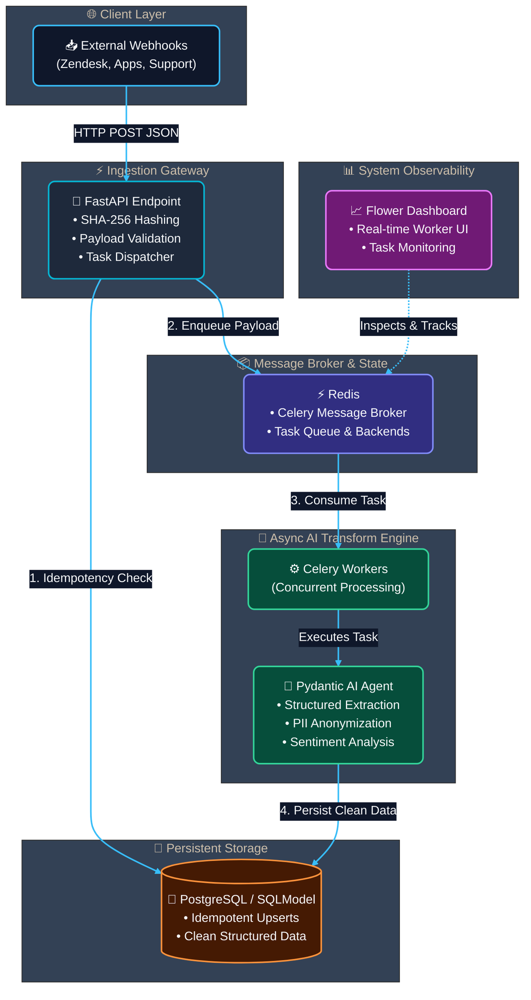

# Asynchronous AI-Powered ETL Pipeline

[](https://fastapi.tiangolo.com/)
[](https://ai.pydantic.dev/)
[](https://docs.celeryq.dev/)
[](https://redis.io/)
[](https://www.postgresql.org/)
[](https://www.docker.com/)

A production-grade, asynchronous ETL (Extract, Transform, Load) pipeline engineered to ingest messy, unstructured data streams (e.g., Zendesk support webhooks, app reviews, customer feedback), enforce strict data contracts using **Pydantic AI**, redact sensitive PII, and guarantee **idempotent persistence** into PostgreSQL.

---

## 📌 Architecture Overview



---

## 🚀 Key Engineering Features

1. **Deterministic Data Contracts (Transform Layer)**
   * Utilizes **Pydantic AI** to turn non-deterministic LLM responses into strictly validated JSON schemas.
   * Automatic retry loops handle model format hallucinations before persisting data to storage.

2. **PII Anonymization & Security**
   * Automatically detects and redacts Personally Identifiable Information (names, emails, phone numbers) at the transform stage to maintain data privacy compliance.

3. **Idempotency via SHA-256 Payload Hashing**
   * Webhooks regularly retry upon network failure. To prevent duplicate database records, the ingestion engine generates a unique SHA-256 fingerprint from payload metadata and raw text (`ON CONFLICT DO NOTHING`).

4. **Async Queue & Decoupled Execution**
   * Heavy LLM calls are offloaded from FastAPI request-response cycles to **Celery** workers using **Redis** as a message broker, ensuring high API throughput.

5. **Real-time Observability**
   * Integrated **Flower** dashboard to monitor task queues, worker concurrency, throughput rates, and retry failures in real time.

---

## 🛠️ Tech Stack

* **API Ingestion:** FastAPI (Python 3.11+)
* **Task Queue & Broker:** Celery, Redis
* **AI Transformation & Extraction:** Pydantic AI, Pydantic v2
* **Database & ORM:** PostgreSQL, SQLModel / SQLAlchemy
* **Monitoring UI:** Flower
* **Containerization:** Docker, Docker Compose

---

## ⚡ Quick Start (Local Setup)

### Prerequisites
* [Docker Desktop](https://www.docker.com/products/docker-desktop/)
* [Git](https://git-scm.com/)

### 1. Clone the Repository
```bash
git clone https://github.com/<your-username>/fastapi-pydantic-ai-etl.git
cd fastapi-pydantic-ai-etl
```

### 2. Configure Environment Variables
Create a `.env` file in the root directory:
```env
POSTGRES_USER=postgres
POSTGRES_PASSWORD=postgres
POSTGRES_DB=feedback_db
POSTGRES_HOST=db
POSTGRES_PORT=5432

REDIS_URL=redis://redis:6379/0
OPENAI_API_KEY=your_openai_api_key_here
```

### 3. Run with Docker Compose
Spin up all microservices (FastAPI, Postgres, Redis, Celery Worker, Flower):
```bash
docker compose up --build -d
```

### 4. Service Endpoints
* **FastAPI Docs:** `http://localhost:8000/docs`
* **Flower Monitoring:** `http://localhost:5555`
* **PostgreSQL:** `localhost:5432`

---

## 🧪 Example Request

Send a raw, messy customer feedback payload via curl:

```bash
curl -X 'POST' \
  'http://localhost:8000/api/v1/feedback' \
  -H 'Content-Type: application/json' \
  -d '{
  "source_id": "TICK-99482",
  "channel": "zendesk_webhook",
  "raw_text": "URGENT! My payment failed for subscription ID 4481. My name is John Doe, call me at 555-0199 or john@example.com ASAP! Fix this app crash!"
}'
```

### Processed Output (Persisted in PostgreSQL):
```json
{
  "id": 1,
  "source_id": "TICK-99482",
  "payload_hash": "e3b0c44298fc1c149afbf4c8996fb92427ae41e4649b934ca495991b7852b855",
  "sanitized_text": "URGENT! My payment failed for subscription ID 4481. My name is [REDACTED], call me at [REDACTED] or [REDACTED] ASAP! Fix this app crash!",
  "category": "Billing & Payments",
  "sentiment": "Negative",
  "urgency": "High",
  "extracted_keywords": ["payment failed", "app crash", "subscription"],
  "created_at": "2026-10-19T08:00:00Z"
}
```

---
